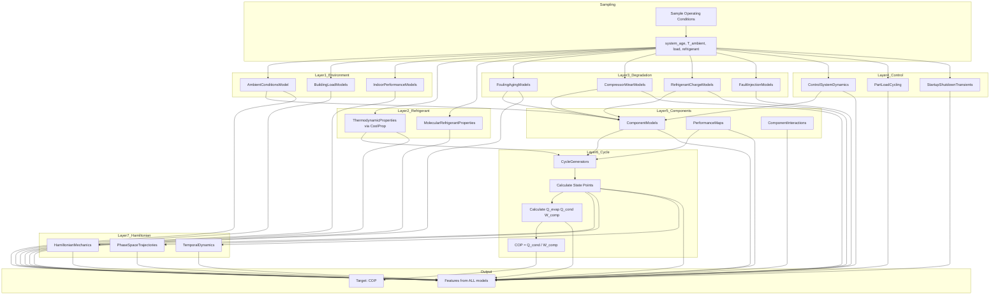

# Comprehensive Physics Model Integration Plan

## Core Concept: Physics Models Generate COP

**The ML model learns**: Given all physics parameters → Predict COP

```
INPUTS (Features from 23+ Physics Models):
├── Thermodynamic state points (T, P, h, s at each cycle point)
├── Component efficiencies (compressor, heat exchangers)
├── Degradation states (fouling, wear, charge deviation)
├── Operating conditions (load, ambient, control signals)
├── Hamiltonian mechanics (energy conservation)
└── All 200+ parameters from physics models

OUTPUT (Calculated by Thermodynamic Cycle):
└── COP = Q_cond / W_comp (from actual physics equations)
```

---

## Part 1: The Complete Physics Model Chain

### Step 1: Sample Operating Conditions
Sample initial conditions that feed into ALL physics models:

```python
# Core operating conditions - sampled randomly
system_age_hours = uniform(0, 40000)           # Affects degradation models
ambient_temp_K = uniform(253, 318)              # -20°C to 45°C
indoor_temp_K = uniform(288, 303)               # 15°C to 30°C
load_demand_kW = uniform(3, 15)                 # Heat pump capacity
refrigerant = choice(['R410A', 'R134a', ...])   # Refrigerant type
maintenance_quality = choice(['poor', 'good', 'excellent'])
```

### Step 2: Call ALL Physics Models in Sequence

```
┌─────────────────────────────────────────────────────────────────────────┐
│                    PHYSICS MODEL CHAIN                                  │
├─────────────────────────────────────────────────────────────────────────┤
│                                                                         │
│  LAYER 1: Environmental Context                                         │
│  ├── ambient_conditions.py → T_wb, T_dp, humidity, solar, wind          │
│  ├── building_load_models.py → Q_heating, Q_cooling, profiles           │
│  └── indoor_performance_models.py → comfort, occupancy                  │
│                                                                         │
│  LAYER 2: Refrigerant Properties                                        │
│  ├── thermodynamic_properties.py → h, s, rho, cp at state points        │
│  └── molecular_refrigerant_properties.py → GWP, critical properties     │
│                                                                         │
│  LAYER 3: Component States                                              │
│  ├── fouling_aging_models.py → evap/cond fouling resistance             │
│  ├── compressor_wear_models.py → efficiency degradation, wear           │
│  ├── refrigerant_charge_models.py → subcooling, superheat effects       │
│  ├── fault_injection_models.py → fault impacts on capacity/COP          │
│  └── performance_maps.py → component efficiency maps                    │
│                                                                         │
│  LAYER 4: Control & Operating Dynamics                                  │
│  ├── control_system_dynamics.py → valve position, compressor speed      │
│  ├── part_load_cycling.py → cycling losses, modulation                  │
│  └── startup_shutdown_transients.py → transient states                  │
│                                                                         │
│  LAYER 5: Detailed Component Physics                                    │
│  ├── component_models.py → W_comp, Q_evap, Q_cond from state points     │
│  └── component_interactions.py → heat/mass transfer between nodes       │
│                                                                         │
│  LAYER 6: Thermodynamic Cycle Calculation                               │
│  ├── cycle_generators.py → Full thermodynamic cycle                     │
│  │   ├── State 1: Evaporator outlet (superheated vapor)                 │
│  │   ├── State 2: Compressor outlet (high P, high T)                    │
│  │   ├── State 3: Condenser outlet (subcooled liquid)                   │
│  │   └── State 4: Expansion valve outlet (two-phase)                    │
│  └── CALCULATE COP = Q_cond / W_comp                                    │
│                                                                         │
│  LAYER 7: Energy Conservation & Hamiltonian                             │
│  ├── hamiltonian_mechanics.py → Energy conservation validation          │
│  ├── phase_space_trajectories.py → System dynamics                      │
│  └── temporal_dynamics.py → Time evolution                              │
│                                                                         │
│  LAYER 8: Validation                                                    │
│  ├── physics_validation_system.py → Carnot check, energy balance        │
│  └── digital_twin_validation.py → Reality check                         │
│                                                                         │
└─────────────────────────────────────────────────────────────────────────┘
```

### Step 3: Collect ALL Outputs as Training Features

Every physics model produces outputs that become training features:

```python
# Example: One complete cycle generation
def generate_one_training_sample():
    features = {}
    
    # === LAYER 1: Environmental ===
    ambient = AmbientConditionsModel()
    ambient_state = ambient.calculate_ambient_conditions(
        dry_bulb_temp_K=sampled_T_ambient,
        relative_humidity_percent=sampled_humidity,
        wind_speed_m_per_s=sampled_wind
    )
    features['ambient_temp_K'] = ambient_state.dry_bulb_temp_K
    features['wet_bulb_temp_K'] = ambient_state.wet_bulb_temp_K
    features['humidity'] = ambient_state.relative_humidity_percent
    features['dew_point_K'] = ambient_state.dew_point_temp_K
    
    # === LAYER 2: Refrigerant Properties ===
    thermo = RefrigerantProperties(refrigerant)
    features['refrigerant_T_crit'] = thermo.T_crit
    features['refrigerant_P_crit'] = thermo.P_crit
    features['refrigerant_GWP'] = thermo.GWP
    
    # === LAYER 3: Component Degradation ===
    fouling = HeatExchangerFoulingModel()
    evap_fouling = fouling.initialize_fouling_state("evap", "finned_tube_evaporator", system_age)
    evap_fouling = fouling.update_fouling_state(evap_fouling, operating_hours, conditions, "finned_tube_evaporator")
    features['evap_fouling_resistance'] = evap_fouling.fouling_resistance
    features['evap_effectiveness_reduction'] = evap_fouling.effectiveness_reduction
    
    cond_fouling = fouling.initialize_fouling_state("cond", "plate_condenser", system_age)
    cond_fouling = fouling.update_fouling_state(cond_fouling, operating_hours, conditions, "plate_condenser")
    features['cond_fouling_resistance'] = cond_fouling.fouling_resistance
    features['cond_effectiveness_reduction'] = cond_fouling.effectiveness_reduction
    
    wear = CompressorWearModel()
    comp_wear = wear.initialize_wear_state("comp", "scroll_compressor", system_age)
    comp_wear = wear.update_wear_state(comp_wear, operating_hours, operating_conditions)
    features['bearing_wear_pct'] = comp_wear.bearing_wear_percentage
    features['valve_leakage_pct'] = comp_wear.valve_leakage_percentage
    features['oil_quality'] = comp_wear.oil_quality_index
    features['compressor_efficiency_degradation'] = comp_wear.efficiency_degradation
    
    charge = RefrigerantChargeModel()
    charge_state = charge.initialize_charge_state("sys", refrigerant, nominal_charge, charge_pct, T_ambient)
    features['charge_level_pct'] = charge_state.charge_level_percentage
    features['subcooling_K'] = charge_state.subcooling_K
    features['superheat_K'] = charge_state.superheat_K
    features['cop_heating_factor'] = charge_state.cop_heating_factor
    
    # === LAYER 4: Control & Operating ===
    control = ControlSystemModel()
    control_state = control.initialize_control_system("sys", "cascade")
    features['compressor_speed_pct'] = control_state.compressor_speed_percent
    features['valve_opening_pct'] = control_state.expansion_valve_opening_percent
    features['fan_speed_evap_pct'] = control_state.evaporator_fan_speed_percent
    features['fan_speed_cond_pct'] = control_state.condenser_fan_speed_percent
    
    part_load = PartLoadCyclingModel()
    pl_state = part_load.initialize_part_load_state("sys", "heat_pump", design_capacity, current_load)
    pl_state = part_load.update_part_load_operation(pl_state, new_load, time_step, T_ambient)
    features['part_load_ratio'] = pl_state.part_load_ratio
    features['part_load_cop'] = pl_state.part_load_cop
    features['is_cycling'] = float(pl_state.is_cycling)
    features['cycles_per_hour'] = pl_state.cycles_per_hour
    
    # === LAYER 5: Component Performance ===
    perf_maps = ComponentPerformanceMaps()
    comp_health = perf_maps.create_component_health("comp", "scroll_compressor", system_age)
    features['health_index'] = comp_health.health_index
    features['efficiency_factor'] = comp_health.efficiency_factor
    features['capacity_factor'] = comp_health.capacity_factor
    
    # === LAYER 6: THERMODYNAMIC CYCLE - This calculates COP! ===
    # Collect all degradation effects
    eta_comp_base = 0.85  # Base efficiency
    eta_comp_actual = eta_comp_base * (1 - comp_wear.efficiency_degradation/100) * comp_health.efficiency_factor
    
    cycle_params = CycleParameters(
        T_evap=T_evap,  # Determined from ambient + approach
        T_cond=T_cond,  # Determined from load requirement
        mass_flow=calculated_mass_flow,
        working_fluid=refrigerant,
        superheat=charge_state.superheat_K,
        subcool=charge_state.subcooling_K,
        eta_comp_isentropic=eta_comp_actual,  # USES DEGRADED EFFICIENCY!
        eta_exp_isentropic=0.80,
        eta_mechanical=0.95,
        eta_motor=0.92,
        dp_evap=5000 * (1 + evap_fouling.effectiveness_reduction/100),  # Fouling increases ΔP
        dp_cond=5000 * (1 + cond_fouling.effectiveness_reduction/100),
        part_load_ratio=pl_state.part_load_ratio
    )
    
    # Generate the actual thermodynamic cycle
    cycle_gen = ImprovedCycleGenerator()
    cycle_result = cycle_gen.generate_cycle_with_retry(CycleType.NON_IDEAL_RANKINE, refrigerant)
    
    # Store all state point data
    for i, state in enumerate(cycle_result.states):
        features[f'state{i+1}_T'] = state.T
        features[f'state{i+1}_P'] = state.P
        features[f'state{i+1}_h'] = state.h
        features[f'state{i+1}_s'] = state.s
        features[f'state{i+1}_rho'] = state.rho
    
    features['Q_evap_kW'] = cycle_result.Q_evap
    features['Q_cond_kW'] = cycle_result.Q_cond
    features['W_comp_kW'] = cycle_result.W_comp
    features['mass_flow_kg_s'] = cycle_result.mass_flow
    
    # === LAYER 7: Hamiltonian Mechanics ===
    hamiltonian = HamiltonianMechanicsModel()
    ham_system = hamiltonian.create_hamiltonian_system('compressor', {'temperature_K': T_cond, 'pressure_Pa': P_cond})
    ham_state = hamiltonian.initialize_hamiltonian_state(ham_system, initial_conditions)
    features['hamiltonian_J'] = ham_state.total_hamiltonian_J
    features['kinetic_energy_J'] = ham_state.kinetic_energy_J
    features['potential_energy_J'] = ham_state.potential_energy_J
    
    # === TARGET: COP calculated from physics! ===
    COP = cycle_result.COP_heating  # This is the TARGET to predict
    
    # Apply final degradation factors (faults, charge, etc.)
    if fault_present:
        fault_model = FaultInjectionModel()
        fault_state = fault_model.inject_fault(...)
        COP *= fault_state.cop_impact_factor
    
    COP *= charge_state.cop_heating_factor  # Charge impact
    
    # Validation
    features['energy_balance_error'] = cycle_result.energy_balance_error
    features['carnot_cop'] = cycle_result.eta_carnot_heating
    features['second_law_efficiency'] = COP / cycle_result.eta_carnot_heating
    
    return features, COP
```

---

## Part 2: Complete Physics Model Integration Map

### All 23 Physics Models and Their Outputs

| # | Model File | Key Outputs (Features) | Used For |
|---|------------|------------------------|----------|
| 1 | `hamiltonian_mechanics.py` | q, p, H, KE, PE trajectories | Energy conservation |
| 2 | `temporal_dynamics.py` | T, P, flow time series | Transient behavior |
| 3 | `control_system_dynamics.py` | Valve position, speed, PID | Control inputs |
| 4 | `startup_shutdown_transients.py` | Phase indicator, transient magnitude | Operating mode |
| 5 | `sensor_noise_models.py` | Noisy measurements | Realistic sensors |
| 6 | `part_load_cycling.py` | PLR, cycling state, part-load COP | Load variation |
| 7 | `phase_space_trajectories.py` | State vector, Lyapunov | System dynamics |
| 8 | `component_interactions.py` | Node features for 10 components | GNN nodes |
| 9 | `gnn_topology.py` | Edge features, graph structure | GNN edges |
| 10 | `fouling_aging_models.py` | Fouling resistance, effectiveness loss | HX degradation |
| 11 | `compressor_wear_models.py` | Bearing wear, valve leakage, efficiency loss | Compressor degradation |
| 12 | `fault_injection_models.py` | Fault type, severity, COP impact | Fault scenarios |
| 13 | `performance_maps.py` | Component efficiency maps | Performance curves |
| 14 | `component_models.py` | W_comp, η_isentropic, η_volumetric | Component physics |
| 15 | `ambient_conditions.py` | T_db, T_wb, humidity, wind | Environment |
| 16 | `indoor_performance_models.py` | T_indoor, comfort index | Indoor conditions |
| 17 | `building_load_models.py` | Q_heating, Q_cooling, load profile | Load demand |
| 18 | `refrigerant_charge_models.py` | Charge %, subcooling, superheat | Charge effects |
| 19 | `molecular_refrigerant_properties.py` | GWP, T_crit, P_crit | Refrigerant data |
| 20 | `thermodynamic_properties.py` | h, s, ρ, cp at all states | State properties |
| 21 | `cycle_generators.py` | **COP, Q_evap, Q_cond, W_comp** | **Main output** |
| 22 | `improved_cycle_generators.py` | Physics-constrained params | Valid parameters |
| 23 | `physics_validation_system.py` | Carnot check, energy balance | Validation |

### Feature Count Summary

```
HNN Branch (Temporal - 100 timesteps):
├── Hamiltonian: 11 features × 100 timesteps
├── Temporal: 10 features × 100 timesteps  
├── Control: 8 features × 100 timesteps
├── Transients: 5 features × 100 timesteps
├── Sensors: 21 features × 100 timesteps
├── Part-load: 4 features × 100 timesteps
└── Phase space: 10 features × 100 timesteps
Total HNN: ~49 features × 100 timesteps = 4,900 values

GNN Branch (Static per cycle):
├── Node features: 10 nodes × 35 features = 350 values
├── Edge features: 11 edges × 12 features = 132 values
└── Graph features: 40 values
Total GNN: ~522 values

Target:
└── COP: 1 value (calculated from thermodynamic cycle)
```

---

## Part 3: Data Flow Diagram



---

## Part 4: Implementation Architecture

### Main Generator Class

```python
class ComprehensivePhysicsGenerator:
    """
    Generates training data using ALL physics models.
    Each sample runs through the complete physics chain.
    """
    
    def __init__(self):
        # Initialize ALL physics models
        self.ambient_model = AmbientConditionsModel()
        self.building_model = BuildingLoadModel()
        self.indoor_model = IndoorPerformanceModel()
        
        self.thermo = {}  # Cache for different refrigerants
        self.molecular = MolecularRefrigerantProperties()
        
        self.fouling_model = HeatExchangerFoulingModel()
        self.wear_model = CompressorWearModel()
        self.charge_model = RefrigerantChargeModel()
        self.fault_model = FaultInjectionModel()
        
        self.control_model = ControlSystemModel()
        self.part_load_model = PartLoadCyclingModel()
        self.transient_model = StartupShutdownTransients()
        
        self.component_model = ComponentModels()
        self.performance_maps = ComponentPerformanceMaps()
        self.interactions = ComponentInteractionModel()
        
        self.cycle_generator = ImprovedCycleGenerator()
        
        self.hamiltonian = HamiltonianMechanicsModel()
        self.phase_space = PhaseSpaceTrajectories()
        self.temporal = TemporalDynamicsGenerator()
        
        self.validator = PhysicsValidationSystem()
    
    def generate_sample(self) -> Tuple[Dict, float]:
        """Generate one complete training sample."""
        
        # 1. Sample initial conditions
        conditions = self._sample_conditions()
        
        # 2. Run through ALL physics layers
        features = {}
        
        # Layer 1: Environment
        env_features = self._run_environmental_models(conditions)
        features.update(env_features)
        
        # Layer 2: Refrigerant properties
        ref_features = self._run_refrigerant_models(conditions)
        features.update(ref_features)
        
        # Layer 3: Degradation
        deg_features = self._run_degradation_models(conditions)
        features.update(deg_features)
        
        # Layer 4: Control
        ctrl_features = self._run_control_models(conditions)
        features.update(ctrl_features)
        
        # Layer 5: Components
        comp_features = self._run_component_models(conditions, deg_features)
        features.update(comp_features)
        
        # Layer 6: Thermodynamic cycle (calculates COP!)
        cycle_result, cycle_features = self._run_cycle_calculation(
            conditions, deg_features, comp_features
        )
        features.update(cycle_features)
        
        # Layer 7: Hamiltonian
        ham_features = self._run_hamiltonian_models(cycle_result)
        features.update(ham_features)
        
        # Extract COP as target
        COP = cycle_result.COP_heating
        
        # Apply remaining degradation factors
        COP = self._apply_degradation_to_cop(COP, deg_features)
        
        # Validate
        is_valid = self.validator.validate(features, COP)
        features['is_valid'] = float(is_valid)
        
        return features, COP
    
    def generate_dataset(self, n_samples: int) -> Tuple[np.ndarray, np.ndarray]:
        """Generate complete training dataset."""
        all_features = []
        all_cops = []
        
        valid_count = 0
        attempt = 0
        
        while valid_count < n_samples and attempt < n_samples * 3:
            attempt += 1
            try:
                features, cop = self.generate_sample()
                if features['is_valid'] and 1.0 <= cop <= 10.0:
                    all_features.append(features)
                    all_cops.append(cop)
                    valid_count += 1
            except Exception as e:
                continue  # Skip failed samples
        
        return self._to_arrays(all_features, all_cops)
```

---

## Part 5: Why This Approach Works for ML

### The Model Learns Actual Physics

| Aspect | How It's Achieved |
|--------|-------------------|
| **COP depends on T_evap, T_cond** | Thermodynamic cycle calculates this |
| **Fouling reduces COP** | Fouling model outputs feed into η calculations |
| **Wear degrades performance** | Compressor wear affects η_isentropic |
| **Charge matters** | Charge model affects subcooling/superheat |
| **Part-load is different** | Part-load model provides cycling effects |
| **Faults cause problems** | Fault model impacts COP directly |

### Feature Correlations Are Physical

```
Example relationships the model will learn:

1. High fouling → Low η_HX → Higher ΔP → Lower COP
   features['evap_fouling'] ↑ → COP ↓

2. Old compressor → Bearing wear → Lower η_comp → Lower COP
   features['system_age'] ↑ → features['bearing_wear'] ↑ → COP ↓

3. Cold ambient → Higher temperature lift → Lower COP
   features['ambient_temp'] ↓ → features['T_cond - T_evap'] ↑ → COP ↓

4. Undercharge → Poor subcooling → Flash gas → Lower COP
   features['charge_level'] < 100 → features['subcooling'] ↓ → COP ↓
```

---

## Part 6: COP Distribution Will Emerge Naturally

By running all physics models with randomly sampled inputs, the COP distribution will **naturally emerge** based on physics:

```
Input Parameter Ranges → Physics Models → COP Distribution

Random T_ambient (253-318K) ─┐
Random system_age (0-40000) ─┼→ All Physics Models → COP (1.5-7.0)
Random charge (70-130%) ────┤
Random load (3-15 kW) ──────┘

The distribution shape comes from:
- Carnot limits at different temperature lifts
- Degradation effects at different ages
- Part-load efficiency curves
- Charge sensitivity curves
```

---

## Summary

**Correct Approach**:
1. Sample operating conditions randomly
2. Pass through ALL 23+ physics models
3. Collect ALL model outputs as training features
4. Calculate COP from thermodynamic cycle
5. ML model learns: `ALL features → COP`

**Wrong Approach** (my previous strata plan):
- Pre-defining COP ranges
- Artificially manipulating distribution
- Not using physics models to generate COP

The physics models ARE the data generator. The COP is their OUTPUT, not our input.
