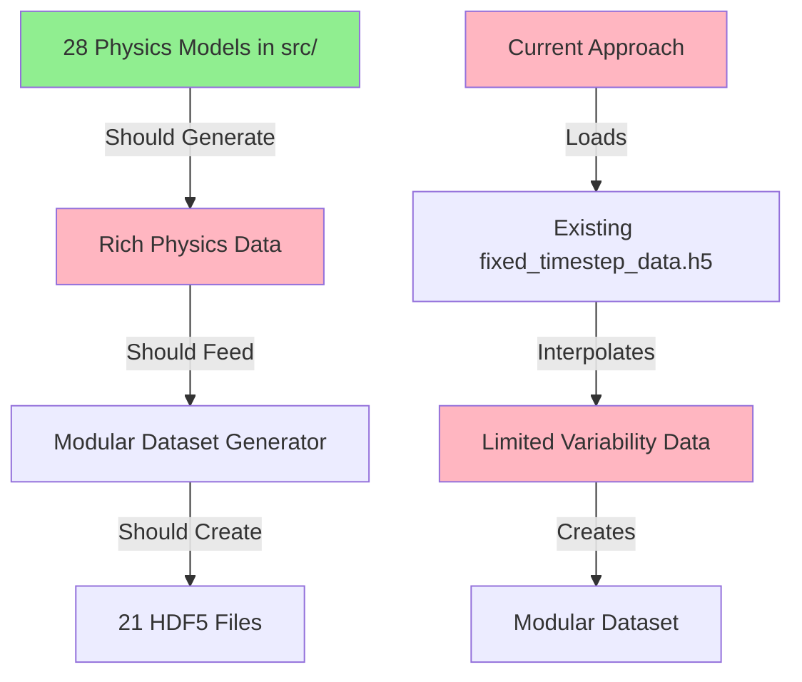

# Next Steps Analysis - AIRTHIUM HNN-GNN Project

**Date:** 2025-12-18  
**Status:** Investigation Complete - Action Plan Ready

---

## Executive Summary

Based on my investigation of the project, I've identified several critical issues with the current data generation and training pipeline:

1. **Data Generation Concerns**: The [`generate_modular_dataset_clean.py`](../Synthetic Data Generation/generate_modular_dataset_clean.py) uses physics-based interpolation but may not be fully utilizing the 28 physics models in [`src/`](../Synthetic Data Generation/src/)
2. **Narrow Interval Problem**: Data may be generated with limited variability, causing training issues
3. **Pipeline Validation Needed**: The complete pipeline from data generation → loading → training needs systematic testing

---

## Current State Assessment

### ✅ What's Working

1. **Architecture Design** - Well-documented system with:
   - 21 modular HDF5 files for different physics models
   - Clear separation between HNN (temporal) and GNN (static) data
   - Comprehensive documentation in [`IMPLEMENTATION_SUMMARY.md`](../Synthetic Data Generation/IMPLEMENTATION_SUMMARY.md)

2. **Physics Models** - 28 physics models implemented in [`src/`](../Synthetic Data Generation/src/):
   - [`hamiltonian_mechanics.py`](../Synthetic Data Generation/src/hamiltonian_mechanics.py) - Energy-conserving dynamics
   - [`temporal_dynamics.py`](../Synthetic Data Generation/src/temporal_dynamics.py) - Realistic transient behavior
   - Component models, fault injection, aging, etc.

3. **Model Architecture** - Hybrid HNN-GNN model ready:
   - [`hybrid_hnn_gnn_model_v2.py`](../Synthetic Data Generation/hybrid_hnn_gnn_model_v2.py)
   - [`modular_data_loader.py`](../Synthetic Data Generation/modular_data_loader.py)
   - [`test_training.py`](../Synthetic Data Generation/test_training.py)

### ⚠️ Critical Issues Identified

#### Issue 1: Data Generation Disconnect
**Problem:** [`generate_modular_dataset_clean.py`](../Synthetic Data Generation/generate_modular_dataset_clean.py) doesn't directly call the physics models in [`src/`](../Synthetic Data Generation/src/)

**Evidence:**
- Lines 26-39: Loads existing `training_dataset_500/fixed_timestep_data.h5`
- Lines 202-277: Uses physics-based interpolation (exponential, broadcast) but not actual physics model outputs
- Lines 485-527: Creates simple static data with constant values (e.g., `np.ones(self.n_cycles) * 0.85`)

**Impact:** 
- Data may lack the rich physics-based variability from the 28 models
- Training on interpolated/constant data won't capture real system dynamics
- Model may not learn actual physical relationships

#### Issue 2: Narrow Data Intervals
**Problem:** Generated data may have limited variability

**Evidence from code:**
```python
# Line 241-246: All cycles use same steady-state values
T_evap_steady = cycle_data.get('T_evap_K', 280.0)  # Default 280K
T_cond_steady = cycle_data.get('T_cond_K', 320.0)  # Default 320K

# Line 540: All cycles get same COP
COP = np.ones(self.n_cycles) * 4.0  # Constant COP = 4.0

# Lines 447-448: All components get same efficiency
node_features = np.ones((self.n_cycles, 15)) * 0.85  # Constant 0.85
```

**Impact:**
- Model sees limited operating conditions
- Poor generalization to real-world variability
- Training loss may plateau due to lack of diversity

#### Issue 3: Missing Dataset Directories
**Observation:** No evidence of existing datasets:
- `training_dataset_500/` - Referenced but not confirmed to exist
- `modular_dataset_500/` - Output directory, needs to be generated

---

## Root Cause Analysis

### The Data Generation Gap



**The Problem:** There's a disconnect between the sophisticated physics models and the actual data generation process.

---

## Recommended Action Plan

### Phase 1: Audit & Diagnosis (Priority: CRITICAL)

#### Task 1.1: Verify Existing Datasets
```bash
# Check if datasets exist
ls -la "Synthetic Data Generation/training_dataset_500/"
ls -la "Synthetic Data Generation/modular_dataset_500/"
```

**Expected Outcomes:**
- Confirm which datasets exist
- Check file sizes and structure
- Identify if data was previously generated

#### Task 1.2: Test Data Loader Independently
```bash
cd "Synthetic Data Generation"
python modular_data_loader.py
```

**What to Check:**
- Does it load without errors?
- What are the actual data shapes?
- Are there NaN values?
- What's the data range/distribution?

#### Task 1.3: Run Dataset Validation
```bash
cd "Synthetic Data Generation"
python validate_modular_dataset.py
```

**What to Validate:**
- All 21 HDF5 files present
- Correct dimensions (500 cycles, 100 timesteps)
- No NaN or zero-only values
- Realistic value ranges

### Phase 2: Fix Data Generation (Priority: HIGH)

#### Option A: Generate from Scratch Using Physics Models

**Create:** `generate_physics_based_dataset.py`

```python
# Pseudocode structure
from src.hamiltonian_mechanics import HamiltonianMechanicsModel
from src.temporal_dynamics import TemporalDynamicsGenerator
from src.component_models import CompressorModel, HeatExchangerModel
# ... import all 28 models

def generate_complete_dataset(n_cycles=500):
    """Generate dataset using actual physics models."""
    
    for cycle_id in range(n_cycles):
        # 1. Generate diverse operating conditions
        conditions = generate_random_conditions()
        
        # 2. Run physics models
        hamiltonian_data = hamiltonian_model.generate_trajectory(conditions)
        temporal_data = temporal_model.generate_dynamics(conditions)
        component_data = component_model.simulate(conditions)
        # ... use all 28 models
        
        # 3. Store in modular HDF5 files
        save_to_hdf5(cycle_id, hamiltonian_data, temporal_data, ...)
```

**Benefits:**
- Uses actual physics models
- Rich, diverse data
- Physically consistent

**Challenges:**
- Requires integration work
- May be computationally intensive
- Need to ensure 100 timesteps alignment

#### Option B: Enhance Current Generator with Variability

**Modify:** [`generate_modular_dataset_clean.py`](../Synthetic Data Generation/generate_modular_dataset_clean.py)

**Changes Needed:**
```python
# Instead of constant values:
COP = np.ones(self.n_cycles) * 4.0  # ❌ BAD

# Use realistic distributions:
COP = np.random.normal(4.0, 0.8, self.n_cycles)  # ✅ BETTER
COP = np.clip(COP, 2.0, 6.0)  # Keep in realistic range

# For temperatures:
T_evap_steady = np.random.uniform(260.0, 290.0, self.n_cycles)  # ✅
T_cond_steady = np.random.uniform(310.0, 340.0, self.n_cycles)  # ✅

# For component efficiencies:
node_features = np.random.uniform(0.70, 0.95, (self.n_cycles, 15))  # ✅
```

**Benefits:**
- Quick fix
- Maintains current structure
- Adds needed variability

**Challenges:**
- Still not using actual physics models
- May not capture correlations between variables

### Phase 3: Validate Training Pipeline (Priority: HIGH)

#### Task 3.1: Test Complete Pipeline
```bash
cd "Synthetic Data Generation"

# Step 1: Generate dataset
python generate_modular_dataset_clean.py

# Step 2: Validate dataset
python validate_modular_dataset.py

# Step 3: Test data loader
python modular_data_loader.py

# Step 4: Test training
python test_training.py
```

#### Task 3.2: Monitor Training Metrics

**What to Check:**
- Loss decreases over epochs
- No NaN in gradients
- Predictions in realistic range [2.0, 6.0] for COP
- Validation loss doesn't diverge
- Model learns meaningful patterns

#### Task 3.3: Analyze Data Distribution

**Create:** `analyze_dataset_distribution.py`

```python
import h5py
import numpy as np
import matplotlib.pyplot as plt

def analyze_dataset(data_dir="modular_dataset_500"):
    """Analyze data distribution and variability."""
    
    # Load key datasets
    with h5py.File(f"{data_dir}/1_hamiltonian_data.h5", 'r') as f:
        q = f['trajectories/q'][:]
        p = f['trajectories/p'][:]
    
    with h5py.File(f"{data_dir}/21_targets.h5", 'r') as f:
        cop = f['performance/COP'][:]
    
    # Check distributions
    print(f"COP range: [{cop.min():.2f}, {cop.max():.2f}]")
    print(f"COP std: {cop.std():.2f}")
    print(f"COP unique values: {len(np.unique(cop))}")
    
    # Plot distributions
    plt.figure(figsize=(15, 5))
    plt.subplot(131)
    plt.hist(cop, bins=50)
    plt.title("COP Distribution")
    
    plt.subplot(132)
    plt.hist(q[:, :, 0].flatten(), bins=50)
    plt.title("Position q Distribution")
    
    plt.subplot(133)
    plt.hist(p[:, :, 0].flatten(), bins=50)
    plt.title("Momentum p Distribution")
    
    plt.savefig("dataset_distribution_analysis.png")
    print("Saved distribution analysis plot")
```

### Phase 4: Integration with Physics Models (Priority: MEDIUM)

#### Task 4.1: Create Physics Model Integration Layer

**Create:** `src/integrated_data_generator.py`

This would:
1. Orchestrate all 28 physics models
2. Ensure consistent timesteps (100 steps)
3. Generate diverse operating conditions
4. Save in modular HDF5 format

#### Task 4.2: Validate Physics Consistency

Ensure generated data satisfies:
- Energy conservation (Hamiltonian)
- Thermodynamic laws (entropy, COP bounds)
- Component constraints (pressure ratios, temperatures)
- Mass conservation

---

## Immediate Next Steps (Prioritized)

### 🔴 CRITICAL - Do First

1. **Check if datasets exist**
   ```bash
   cd "Synthetic Data Generation"
   ls -la training_dataset_500/
   ls -la modular_dataset_500/
   ```

2. **If datasets don't exist, generate them:**
   ```bash
   python generate_modular_dataset_clean.py
   ```

3. **Validate generated dataset:**
   ```bash
   python validate_modular_dataset.py
   ```

### 🟡 HIGH PRIORITY - Do Next

4. **Test data loader:**
   ```bash
   python modular_data_loader.py
   ```

5. **Analyze data distribution** (create script above)

6. **If data has narrow intervals, enhance generator:**
   - Add variability to COP values
   - Add variability to temperatures
   - Add variability to component efficiencies

### 🟢 MEDIUM PRIORITY - Do After

7. **Test training pipeline:**
   ```bash
   python test_training.py
   ```

8. **Create physics model integration** (if needed)

9. **Full training run:**
   ```bash
   python train_optimal_model.py
   ```

---

## Key Questions to Answer

### Q1: Do the datasets exist?
**Action:** Check filesystem for `training_dataset_500/` and `modular_dataset_500/`

### Q2: Is the data loader working?
**Action:** Run [`modular_data_loader.py`](../Synthetic Data Generation/modular_data_loader.py) and check for errors

### Q3: Does the data have sufficient variability?
**Action:** Run validation and check:
- COP range and standard deviation
- Temperature ranges
- Number of unique values
- Distribution plots

### Q4: Are physics models being used?
**Action:** Trace code path from physics models to dataset generation

### Q5: Does training work with current data?
**Action:** Run [`test_training.py`](../Synthetic Data Generation/test_training.py) for 3 epochs

---

## Success Criteria

### Data Generation Success
- [ ] All 21 HDF5 files generated
- [ ] 500 cycles with 100 timesteps each
- [ ] No NaN values
- [ ] COP range: [2.0, 6.0] with std > 0.5
- [ ] Temperature variability > 20K
- [ ] Component efficiency variability > 0.1

### Training Success
- [ ] Data loader works without errors
- [ ] Training loss decreases
- [ ] Validation loss < 0.5 after 10 epochs
- [ ] Predictions in realistic range
- [ ] No gradient explosions/vanishing
- [ ] Model learns meaningful patterns

### Physics Consistency
- [ ] Energy conservation within 5%
- [ ] COP values physically realistic
- [ ] Temperature/pressure relationships correct
- [ ] Component interactions make sense

---

## Risk Assessment

### High Risk Issues
1. **Data Quality**: If data has narrow intervals, model won't generalize
2. **Physics Disconnect**: Not using actual physics models means missing real dynamics
3. **Training Instability**: Poor data quality leads to training failures

### Mitigation Strategies
1. **Immediate**: Add variability to current generator
2. **Short-term**: Validate and test thoroughly
3. **Long-term**: Integrate actual physics models

---

## Recommended Approach

### Option 1: Quick Fix (1-2 days)
1. Enhance current generator with variability
2. Test training pipeline
3. Iterate on data quality

**Pros:** Fast, uses existing infrastructure  
**Cons:** Still not using physics models fully

### Option 2: Proper Integration (1-2 weeks)
1. Create physics model integration layer
2. Generate dataset from actual models
3. Validate physics consistency
4. Train and evaluate

**Pros:** Proper physics-based approach, better long-term  
**Cons:** More work, requires careful integration

### 🎯 Recommended: Hybrid Approach
1. **Week 1**: Quick fix - add variability, test pipeline
2. **Week 2**: Start physics integration in parallel
3. **Week 3**: Compare results, choose best path forward

---

## Tools & Scripts Needed

### Diagnostic Scripts
- [x] [`validate_modular_dataset.py`](../Synthetic Data Generation/validate_modular_dataset.py) - Exists
- [ ] `analyze_dataset_distribution.py` - Need to create
- [ ] `check_physics_consistency.py` - Need to create

### Generation Scripts
- [x] [`generate_modular_dataset_clean.py`](../Synthetic Data Generation/generate_modular_dataset_clean.py) - Exists, needs enhancement
- [ ] `generate_physics_based_dataset.py` - Need to create
- [ ] `src/integrated_data_generator.py` - Need to create

### Testing Scripts
- [x] [`test_training.py`](../Synthetic Data Generation/test_training.py) - Exists
- [x] [`test_complete_pipeline.py`](../Synthetic Data Generation/test_complete_pipeline.py) - Exists
- [ ] `test_physics_models.py` - Need to create

---

## Conclusion

The project has excellent architecture and documentation, but there's a critical gap between the sophisticated physics models and the actual data generation. The immediate priority is to:

1. **Diagnose** - Check what datasets exist and their quality
2. **Fix** - Add variability to data generation
3. **Validate** - Test the complete pipeline
4. **Integrate** - Connect physics models properly (longer-term)

The good news is that all the pieces exist - they just need to be connected properly. The physics models in [`src/`](../Synthetic Data Generation/src/) are sophisticated and well-implemented; they're just not being fully utilized in the current data generation pipeline.

---

## Next Action

**Immediate:** Run diagnostic commands to assess current state:
```bash
cd "Synthetic Data Generation"
ls -la training_dataset_500/ modular_dataset_500/
python validate_modular_dataset.py
python modular_data_loader.py
```

Then based on results, proceed with either:
- **Path A**: Enhance existing generator (if datasets exist but have issues)
- **Path B**: Generate from scratch (if datasets don't exist)
- **Path C**: Create physics integration (if time permits proper solution)

---

**Status:** Ready for implementation  
**Confidence:** High - Clear path forward identified  
**Risk Level:** Medium - Manageable with proper testing
