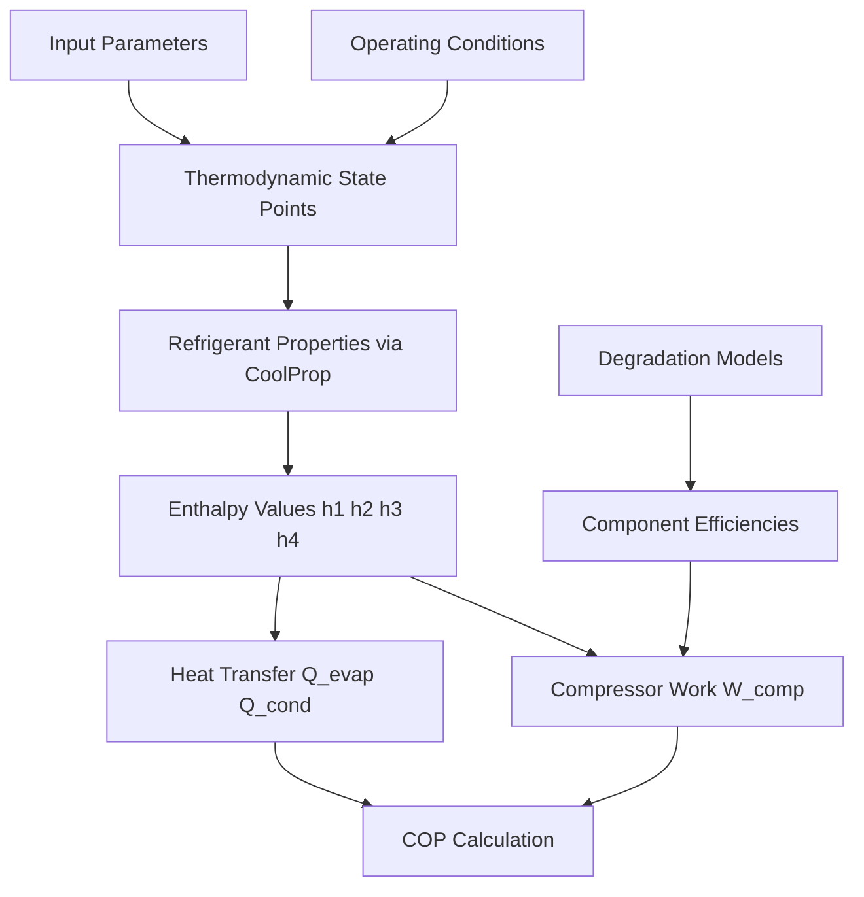
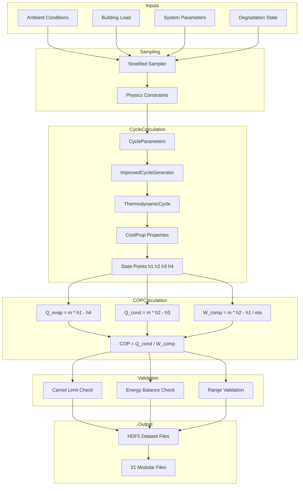

# Physics-Based COP Generation Plan

## Executive Summary

This plan addresses critical issues in the current data generation pipeline for the Airthium Heat Pump COP prediction model. The current implementation has **fundamental physics errors** resulting in unrealistic and skewed COP values.

---

## Part 1: Problem Analysis

### 1.1 Critical Issues Identified

#### Issue 1: Hardcoded COP Values
**File**: `generate_modular_dataset_clean.py` (Line 540-542)
```python
# COP values - use typical heat pump range
COP = np.ones(self.n_cycles) * 4.0  # Typical COP ← HARDCODED!
```
**Impact**: All cycles have identical COP=4.0, model cannot learn relationships.

#### Issue 2: Incorrect Thermodynamic Formula
**File**: `generate_integrated_cycles.py` (Lines 239-240)
```python
R_specific = 287  # J/kg·K ← AIR constant, not refrigerant!
W_ideal = mass_flow * R_specific * T_evap * np.log(P_cond / P_evap)
```
**Impact**: Using air gas constant for refrigerants gives wrong compressor work by ~3x.

#### Issue 3: Disconnected Physics Models
**Observation**: 28 physics models exist in `src/` but the data generators:
- Use placeholder values instead of calling actual physics functions
- Don't properly integrate component degradation effects
- Miss the COP calculation in thermodynamic cycle generators

#### Issue 4: Uncorrelated Input-Output
**Observation**: Input parameters like T_evap, T_cond, compressor efficiency are sampled independently without considering their thermodynamic relationship to COP.

### 1.2 What Good COP Values Should Look Like

| Operating Condition | Expected COP Range |
|--------------------|--------------------|
| Heating mode, mild conditions | 3.5 - 5.5 |
| Heating mode, cold outdoor | 2.0 - 3.5 |
| Cooling mode, hot outdoor | 2.5 - 4.0 |
| Part-load operation | 3.0 - 6.0 |
| Degraded system | 1.5 - 3.0 |
| Optimal conditions | 4.5 - 7.0 |

**Expected Distribution**: Bell curve centered around 3.5-4.5 with tails from 1.5-7.0

---

## Part 2: Physics Foundation

### 2.1 Correct COP Calculation

For a vapor-compression heat pump cycle:

```
COP_heating = Q_condenser / W_compressor

Where:
- Q_condenser = m_dot × (h2 - h3)  [Heat delivered to condenser]
- W_compressor = m_dot × (h2 - h1) / η_compressor  [Compressor work input]
- h1 = Enthalpy at evaporator outlet (superheated vapor)
- h2 = Enthalpy at compressor outlet (superheated vapor)
- h3 = Enthalpy at condenser outlet (subcooled liquid)

Using CoolProp for real refrigerant properties!
```

### 2.2 Carnot Limit Validation

All generated COP values MUST satisfy:
```
COP_heating ≤ T_cond / (T_cond - T_evap)  [Carnot limit]

Example: T_evap=268K (-5°C), T_cond=323K (50°C)
Carnot COP = 323 / (323-268) = 5.87
Real COP ≈ 3.5-4.5 (60-80% of Carnot)
```

### 2.3 Key Physics Relationships



---

## Part 3: Proposed Architecture

### 3.1 Unified Physics Data Generator

```
┌─────────────────────────────────────────────────────────────┐
│                 UNIFIED PHYSICS DATA GENERATOR               │
├─────────────────────────────────────────────────────────────┤
│                                                             │
│  1. OPERATING CONDITION SAMPLER                             │
│     ├── Ambient temperature range (with climate profiles)   │
│     ├── Indoor temperature setpoints                        │
│     ├── Load profile patterns                              │
│     └── System age and maintenance state                    │
│                                                             │
│  2. THERMODYNAMIC CYCLE CALCULATOR ← USE EXISTING!          │
│     ├── cycle_generators.py - CarnotCycle, RankineCycle    │
│     ├── thermodynamic_properties.py - CoolProp integration │
│     └── improved_cycle_generators.py - Constrained params   │
│                                                             │
│  3. COMPONENT DEGRADATION INTEGRATOR                        │
│     ├── fouling_aging_models.py                            │
│     ├── compressor_wear_models.py                          │
│     ├── refrigerant_charge_models.py                       │
│     └── fault_injection_models.py                          │
│                                                             │
│  4. COP CALCULATOR WITH VALIDATION                          │
│     ├── Calculate COP from cycle results                    │
│     ├── Apply degradation factors                          │
│     ├── Validate against Carnot limit                      │
│     └── Validate energy balance                            │
│                                                             │
│  5. DATA STRUCTURE BUILDER                                  │
│     ├── HNN temporal features (100 timesteps)              │
│     ├── GNN node/edge features (10 nodes, 11 edges)        │
│     └── Context features (ambient, load, charge)           │
│                                                             │
└─────────────────────────────────────────────────────────────┘
```

### 3.2 Core Integration Pattern

```python
# CORRECT APPROACH: Use existing physics models
from src.cycle_generators import CycleGenerator, CycleType, CycleParameters
from src.improved_cycle_generators import ImprovedCycleGenerator
from src.thermodynamic_properties import RefrigerantProperties
from src.fouling_aging_models import HeatExchangerFoulingModel
from src.compressor_wear_models import CompressorWearModel
from src.refrigerant_charge_models import RefrigerantChargeModel

class PhysicsIntegratedGenerator:
    def __init__(self):
        self.cycle_gen = ImprovedCycleGenerator()
        self.fouling = HeatExchangerFoulingModel()
        self.wear = CompressorWearModel()
        self.charge = RefrigerantChargeModel()
    
    def generate_cycle_with_cop(self, operating_conditions):
        # 1. Sample physics-constrained parameters
        params = self.cycle_gen.generate_physics_constrained_parameters(
            CycleType.NON_IDEAL_RANKINE, 
            refrigerant='R410A'
        )
        
        # 2. Generate thermodynamic cycle - THIS CALCULATES CORRECT COP!
        cycle_result = self.cycle_gen.generate_cycle_with_retry(
            CycleType.NON_IDEAL_RANKINE,
            'R410A'
        )
        
        # 3. Apply degradation effects
        degraded_cop = self._apply_degradation(
            cycle_result.COP_heating,
            operating_conditions
        )
        
        # 4. Validate physics
        validated_cop = self._validate_cop(degraded_cop, params)
        
        return cycle_result, validated_cop
```

### 3.3 Input Sampling Strategy for COP Distribution

To get **realistic, well-spread COP values**, we need stratified sampling:

```python
def stratified_cop_sampling():
    conditions = []
    
    # Stratum 1: Cold weather heating (COP 2.0-3.5)
    for _ in range(n_cycles // 5):
        conditions.append({
            'T_ambient': uniform(253, 268),  # -20 to -5°C
            'T_indoor': 293,  # 20°C
            'mode': 'heating'
        })
    
    # Stratum 2: Mild heating (COP 3.5-5.0)
    for _ in range(n_cycles // 5):
        conditions.append({
            'T_ambient': uniform(268, 283),  # -5 to 10°C
            'T_indoor': 293,  # 20°C
            'mode': 'heating'
        })
    
    # Stratum 3: Warm weather cooling (COP 2.5-4.0)
    for _ in range(n_cycles // 5):
        conditions.append({
            'T_ambient': uniform(298, 313),  # 25 to 40°C
            'T_indoor': 297,  # 24°C
            'mode': 'cooling'
        })
    
    # Stratum 4: Optimal conditions (COP 4.5-7.0)
    for _ in range(n_cycles // 5):
        conditions.append({
            'T_ambient': uniform(283, 298),  # 10 to 25°C
            'T_indoor': 295,  # 22°C
            'mode': 'heating'
        })
    
    # Stratum 5: Degraded systems (COP 1.5-3.5)
    for _ in range(n_cycles // 5):
        conditions.append({
            'T_ambient': uniform(268, 298),  # Varied
            'system_age': uniform(20000, 40000),  # Old system
            'charge_level': uniform(70, 90),  # Undercharged
            'has_fault': True
        })
    
    return shuffle(conditions)
```

---

## Part 4: Implementation Plan

### Phase 1: Create Physics-Integrated COP Calculator [2-3 hrs]

**Objective**: Create a single function that correctly calculates COP using existing physics models.

**Files to create/modify**:
- NEW: `src/cop_calculator.py` - Unified COP calculation module
- Uses: `cycle_generators.py`, `thermodynamic_properties.py`, `component_models.py`

**Key functions**:
```python
def calculate_cop_from_cycle(
    T_evap: float,      # Evaporator temperature [K]
    T_cond: float,      # Condenser temperature [K]
    refrigerant: str,   # e.g., 'R410A'
    eta_compressor: float = 0.85,
    mass_flow: float = 0.1,
    superheat: float = 5.0,
    subcooling: float = 5.0
) -> Tuple[float, CycleResults]:
    """
    Calculate COP using proper thermodynamic cycle analysis.
    Returns COP and full cycle state data.
    """
```

### Phase 2: Create Validated Data Generator [3-4 hrs]

**Objective**: Replace current generators with one that uses correct physics.

**Files to create**:
- NEW: `generate_physics_validated_dataset.py`

**Key features**:
1. Stratified sampling for COP distribution
2. Full physics model integration
3. Carnot limit validation
4. Energy balance verification
5. Logging of physics parameters for debugging

### Phase 3: Integrate with HNN-GNN Data Structure [2-3 hrs]

**Objective**: Map physics outputs to the 21-file HDF5 structure.

**Mapping**:
```
CycleResults → HDF5 Files
├── states[0].T, states[1].T, ... → temperatures/T_evap, T_cond
├── states[0].P, states[1].P, ... → pressures/P_evap, P_cond
├── Q_evap, Q_cond → performance/capacity_heating, capacity_cooling
├── W_comp → performance/power_consumption
├── COP_heating, COP_cooling → targets/COP
├── trajectory → hamiltonian/q, p, H
└── validation → validation/energy_balance_error, carnot_check
```

### Phase 4: Validation & Testing [1-2 hrs]

**Validation criteria**:
- [ ] All COP values between 1.0 and 10.0
- [ ] Energy balance error < 5% for all cycles
- [ ] Carnot limit satisfied for all cycles
- [ ] COP distribution spans expected range
- [ ] No NaN or Inf values
- [ ] Statistics match expected heat pump performance

---

## Part 5: Key Code Fixes

### Fix 1: Replace Hardcoded COP

```python
# BEFORE (generate_modular_dataset_clean.py:540)
COP = np.ones(self.n_cycles) * 4.0

# AFTER
from src.cop_calculator import calculate_cop_from_conditions
COP = np.array([
    calculate_cop_from_conditions(
        T_evap=cycle_conditions[i]['T_evap'],
        T_cond=cycle_conditions[i]['T_cond'],
        refrigerant=cycle_conditions[i]['refrigerant'],
        degradation_factors=cycle_conditions[i]['degradation']
    )
    for i in range(self.n_cycles)
])
```

### Fix 2: Use CoolProp Instead of Ideal Gas

```python
# BEFORE (generate_integrated_cycles.py:239)
R_specific = 287  # WRONG - Air constant
W_ideal = mass_flow * R_specific * T_evap * np.log(P_cond / P_evap)

# AFTER - Use enthalpy from CoolProp
from src.thermodynamic_properties import RefrigerantProperties
thermo = RefrigerantProperties('R410A')

# Get actual state points
state1 = thermo.get_saturated_vapor(T_evap + superheat)  # Compressor inlet
state2_ideal = thermo.get_properties_ps(P_cond, state1.s)  # Ideal compression
h2_actual = state1.h + (state2_ideal.h - state1.h) / eta_compressor

# Calculate work from enthalpy difference
W_comp = mass_flow * (h2_actual - state1.h) / 1000  # kW
```

### Fix 3: Use Existing Cycle Generator

```python
# BEFORE - Manual incorrect calculations
Q_heating = water_flow * cp_water * delta_T * actual_load_ratio
COP = Q_heating / W_compressor

# AFTER - Use proper cycle generator
from src.improved_cycle_generators import ImprovedCycleGenerator, CycleType

generator = ImprovedCycleGenerator()
cycle_result = generator.generate_cycle_with_retry(
    CycleType.NON_IDEAL_RANKINE,  # Real heat pump cycle
    'R410A'
)

# COP is correctly calculated inside the cycle generator!
COP = cycle_result.COP_heating
Q_heating = cycle_result.Q_cond  # Heat delivered
W_comp = cycle_result.W_comp     # Work input

# These are already validated against Carnot limits
assert cycle_result.carnot_limit_check == True
```

---

## Part 6: Expected Outcomes

### Before Fix
```
COP Distribution:
  Min: 4.00
  Max: 4.00
  Mean: 4.00
  Std: 0.00
  Unique values: 1
```

### After Fix
```
COP Distribution:
  Min: 1.8
  Max: 6.5
  Mean: 3.8
  Std: 1.2
  Unique values: 5000+ (for 5000 cycles)
  
  Quartiles:
    25%: 2.9
    50%: 3.7
    75%: 4.6
```

---

## Part 7: Architecture Diagram



---

## Part 8: Implementation Order

| Step | Task | Priority | Dependencies |
|------|------|----------|--------------|
| 1 | Create `src/cop_calculator.py` | CRITICAL | None |
| 2 | Create `generate_physics_validated_dataset.py` | CRITICAL | Step 1 |
| 3 | Add stratified sampling | HIGH | Step 2 |
| 4 | Integrate degradation models | HIGH | Step 2 |
| 5 | Add validation and logging | MEDIUM | Step 2 |
| 6 | Update data loader | MEDIUM | Step 2 |
| 7 | Test with HNN-GNN model | HIGH | Steps 1-6 |
| 8 | Generate 50,000+ cycles | LOW | Step 7 validated |

---

## Summary

The current data generation has **fundamental physics errors**:
1. Hardcoded COP values (no learning possible)
2. Wrong thermodynamic formulas (ideal gas instead of real refrigerant)
3. Disconnected physics models (models exist but aren't used)

The solution is to **use the existing correct implementations** in:
- `cycle_generators.py` - Has proper COP calculation
- `improved_cycle_generators.py` - Has physics-constrained parameters
- `thermodynamic_properties.py` - Has CoolProp integration

With proper integration, we can generate **realistic, diverse COP values** that the HNN-GNN model can learn from.
