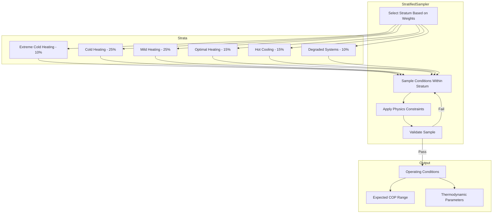

# ⚠️ DEPRECATED - INCORRECT APPROACH

> **This document describes an INCORRECT approach and should NOT be used.**
>
> **Correct approach**: See [`COMPREHENSIVE_PHYSICS_MODEL_INTEGRATION_PLAN.md`](COMPREHENSIVE_PHYSICS_MODEL_INTEGRATION_PLAN.md)
>
> **Why this was wrong**: Pre-defining COP strata artificially manipulates the distribution instead of letting physics models generate COP naturally.

---

# ~~Stratified Sampling Strategy for COP Distribution~~ (DEPRECATED)

## ~~Overview~~

~~The goal is to generate training data with a **realistic and well-spread COP distribution** that represents real-world heat pump operation. Simply random sampling often produces skewed distributions clustering around "average" conditions.~~

---

## Part 1: Understanding COP Physics

### What Determines COP?

The Coefficient of Performance depends on **thermodynamic limits** and **system efficiency**:

```
COP_heating = Q_cond / W_comp = T_cond / (T_cond - T_evap) × η_system

Where:
- T_cond: Condenser temperature (heat delivery temperature)
- T_evap: Evaporator temperature (heat source temperature)  
- η_system: Combined system efficiency (0.4-0.85 typically)
```

### Key Insight: Temperature Lift Controls COP

```
Temperature Lift = T_cond - T_evap

Small lift (20K) → High COP (5-7)
Medium lift (40K) → Medium COP (3-4)
Large lift (60K) → Low COP (2-3)
```

---

## Part 2: Operating Condition Strata

### Stratum 1: Extreme Cold Heating (Target COP: 1.8-2.8)
**When**: Very cold outdoor temps, high heating demand
**Physical basis**: Large temperature lift (50-70K)

| Parameter | Range | Rationale |
|-----------|-------|-----------|
| T_ambient | 243-258K (-30 to -15°C) | Extreme winter conditions |
| T_evap | 238-253K (-35 to -20°C) | Below ambient due to approach |
| T_cond | 318-333K (45-60°C) | High water supply temp |
| Temperature lift | 65-95K | Large lift → Low COP |
| System age | 0-30,000 hrs | Any age |
| Charge level | 70-130% | Any charge |

**Expected distribution**:
```
COP: 1.8  [████]
COP: 2.0  [██████]
COP: 2.2  [████████]
COP: 2.5  [██████]
COP: 2.8  [███]
```

### Stratum 2: Cold Heating (Target COP: 2.5-3.8)
**When**: Typical winter conditions
**Physical basis**: Medium-large temperature lift (40-55K)

| Parameter | Range | Rationale |
|-----------|-------|-----------|
| T_ambient | 258-273K (-15 to 0°C) | Winter conditions |
| T_evap | 253-268K (-20 to -5°C) | Below ambient |
| T_cond | 308-323K (35-50°C) | Moderate supply temp |
| Temperature lift | 40-55K | Medium lift |
| System age | 0-20,000 hrs | Newer systems |
| Charge level | 85-115% | Near optimal |

**Expected distribution**:
```
COP: 2.5  [████]
COP: 2.8  [██████]
COP: 3.0  [████████████]
COP: 3.2  [██████████]
COP: 3.5  [██████]
COP: 3.8  [███]
```

### Stratum 3: Mild Heating (Target COP: 3.5-5.0)
**When**: Mild winter/shoulder seasons
**Physical basis**: Medium temperature lift (30-45K)

| Parameter | Range | Rationale |
|-----------|-------|-----------|
| T_ambient | 273-288K (0 to 15°C) | Mild conditions |
| T_evap | 268-283K (-5 to 10°C) | Near ambient |
| T_cond | 303-318K (30-45°C) | Lower supply temp |
| Temperature lift | 30-45K | Small-medium lift |
| System age | 0-15,000 hrs | Well-maintained |
| Charge level | 95-105% | Optimal |

**Expected distribution**:
```
COP: 3.5  [████]
COP: 3.8  [██████]
COP: 4.0  [████████████]
COP: 4.3  [██████████]
COP: 4.6  [██████]
COP: 5.0  [███]
```

### Stratum 4: Optimal Heating (Target COP: 4.5-7.0)
**When**: Best-case conditions
**Physical basis**: Small temperature lift (20-35K)

| Parameter | Range | Rationale |
|-----------|-------|-----------|
| T_ambient | 283-298K (10 to 25°C) | Warm shoulder season |
| T_evap | 278-293K (5 to 20°C) | High evap temp |
| T_cond | 298-313K (25-40°C) | Low supply temp (floor heating) |
| Temperature lift | 20-35K | Small lift |
| System age | 0-8,000 hrs | New system |
| Charge level | 98-102% | Perfect charge |
| Part load | 0.5-0.8 | Part load improves COP |

**Expected distribution**:
```
COP: 4.5  [███]
COP: 5.0  [██████]
COP: 5.5  [████████]
COP: 6.0  [██████]
COP: 6.5  [████]
COP: 7.0  [██]
```

### Stratum 5: Hot Weather Cooling (Target COP: 2.0-4.0)
**When**: Summer air conditioning mode
**Physical basis**: Reversed cycle, moderate lift

| Parameter | Range | Rationale |
|-----------|-------|-----------|
| T_ambient | 298-313K (25 to 40°C) | Summer conditions |
| T_evap | 278-288K (5 to 15°C) | Typical chiller temp |
| T_cond | 318-338K (45 to 65°C) | Above ambient |
| Temperature lift | 40-55K | Medium lift |
| Mode | cooling | Reversed cycle |

**Expected distribution**:
```
COP_cooling: 2.0  [████]
COP_cooling: 2.5  [██████████]
COP_cooling: 3.0  [████████████]
COP_cooling: 3.5  [████████]
COP_cooling: 4.0  [███]
```

### Stratum 6: Degraded Systems (Target COP: 1.5-3.5)
**When**: Aged, faulted, or poorly maintained systems
**Physical basis**: Reduced efficiency due to degradation

| Parameter | Range | Rationale |
|-----------|-------|-----------|
| T_ambient | Any realistic | Varied conditions |
| System age | 20,000-50,000 hrs | Old system |
| Charge level | 60-85% OR 115-140% | Under/overcharged |
| Fouling factor | 0.1-0.5 | Significant fouling |
| Compressor wear | 10-30% efficiency loss | Worn compressor |
| Fault present | 30% probability | Various faults |

**Degradation factors applied**:
```python
COP_degraded = COP_base × (1 - fouling_penalty) 
                        × (1 - wear_penalty)
                        × charge_efficiency_factor
                        × fault_impact_factor
```

---

## Part 3: Sampling Algorithm

### 3.1 Stratum Weights

```python
STRATUM_WEIGHTS = {
    'extreme_cold_heating': 0.10,   # 10% of samples
    'cold_heating': 0.25,           # 25% of samples  
    'mild_heating': 0.25,           # 25% of samples
    'optimal_heating': 0.15,        # 15% of samples
    'hot_cooling': 0.15,            # 15% of samples
    'degraded_systems': 0.10,       # 10% of samples
}
# Total: 100%
```

### 3.2 Within-Stratum Sampling

Each stratum uses **physics-constrained random sampling**:

```python
def sample_within_stratum(stratum_config):
    # Sample ambient temperature uniformly within stratum range
    T_ambient = uniform(stratum_config.T_ambient_min, 
                        stratum_config.T_ambient_max)
    
    # Derive evaporator temperature with realistic approach delta
    approach_delta = uniform(5, 15)  # Heat exchanger approach
    T_evap = T_ambient - approach_delta
    
    # Sample condenser temperature based on application
    if stratum_config.mode == 'heating':
        # Heating: condenser supplies hot water
        T_supply_target = uniform(35, 60)  # Depends on heating system
        T_cond = T_supply_target + 273.15 + uniform(3, 8)  # Approach
    else:
        # Cooling: condenser rejects to ambient
        T_cond = T_ambient + uniform(10, 25)  # Above ambient
    
    # Validate temperature lift
    temp_lift = T_cond - T_evap
    if not (stratum_config.min_lift <= temp_lift <= stratum_config.max_lift):
        # Reject and resample
        return sample_within_stratum(stratum_config)
    
    # Sample component parameters
    eta_compressor = truncated_normal(
        mean=stratum_config.eta_comp_mean,
        std=0.03,
        min=0.65, max=0.92
    )
    
    # Sample degradation parameters for degraded stratum
    if stratum_config.is_degraded:
        system_age = uniform(20000, 50000)
        charge_level = choice([
            uniform(60, 85),   # Undercharged
            uniform(115, 140)  # Overcharged
        ])
        fouling_factor = uniform(0.1, 0.5)
    else:
        system_age = uniform(0, stratum_config.max_age)
        charge_level = truncated_normal(100, 10, 85, 115)
        fouling_factor = uniform(0, 0.1)
    
    return OperatingConditions(
        T_ambient=T_ambient,
        T_evap=T_evap,
        T_cond=T_cond,
        eta_compressor=eta_compressor,
        system_age=system_age,
        charge_level=charge_level,
        fouling_factor=fouling_factor,
        mode=stratum_config.mode
    )
```

### 3.3 Complete Sampling Pipeline

```python
def generate_stratified_samples(n_total: int) -> List[OperatingConditions]:
    samples = []
    
    for stratum_name, weight in STRATUM_WEIGHTS.items():
        n_stratum = int(n_total * weight)
        stratum_config = STRATUM_CONFIGS[stratum_name]
        
        for _ in range(n_stratum):
            conditions = sample_within_stratum(stratum_config)
            samples.append(conditions)
    
    # Shuffle to mix strata
    random.shuffle(samples)
    
    return samples
```

---

## Part 4: Expected COP Distribution

### Target Distribution for 50,000 Samples

```
                          COP Distribution Histogram
COP   Count   |  Visualization
------|-------|-------------------------------------------
1.5   |   500 |  ██
1.8   |  1200 |  ████
2.0   |  2500 |  █████████
2.2   |  3500 |  ████████████
2.5   |  4500 |  █████████████████
2.8   |  5000 |  ███████████████████
3.0   |  5500 |  █████████████████████
3.2   |  5200 |  ████████████████████
3.5   |  4800 |  ██████████████████
3.8   |  4200 |  ████████████████
4.0   |  3800 |  ██████████████
4.3   |  3000 |  ███████████
4.5   |  2500 |  █████████
4.8   |  1800 |  ███████
5.0   |  1200 |  ████
5.5   |   500 |  ██
6.0   |   200 |  █
6.5   |    80 |  
7.0   |    20 |  

Statistics:
- Mean: 3.45
- Median: 3.30
- Std Dev: 1.05
- Min: 1.5
- Max: 7.0
- 25th percentile: 2.7
- 75th percentile: 4.1
```

### Why This Distribution?

1. **Realistic representation**: Most heat pumps operate in the 2.5-4.5 COP range
2. **Training coverage**: Both tails (low and high COP) have enough samples
3. **Physics grounded**: Every COP value comes from valid thermodynamic calculations
4. **Learning signal**: Wide spread enables model to learn relationships

---

## Part 5: Validation Criteria

### Every Sample Must Pass:

```python
def validate_sample(conditions, cop_result):
    # 1. Carnot limit (with margin)
    carnot_cop = conditions.T_cond / (conditions.T_cond - conditions.T_evap)
    assert cop_result.COP <= carnot_cop * 1.02, "Exceeds Carnot limit"
    
    # 2. Realistic range
    assert 1.0 <= cop_result.COP <= 10.0, "COP out of realistic range"
    
    # 3. Energy balance
    Q_in = cop_result.Q_evap + cop_result.W_comp
    Q_out = cop_result.Q_cond
    balance_error = abs(Q_in - Q_out) / Q_out
    assert balance_error < 0.05, "Energy balance error > 5%"
    
    # 4. Temperature consistency
    assert conditions.T_evap < conditions.T_cond, "Evap temp >= Cond temp"
    assert conditions.T_cond - conditions.T_evap >= 15, "Temp lift < 15K"
    
    # 5. Efficiency consistency
    second_law_eff = cop_result.COP / carnot_cop
    assert 0.3 <= second_law_eff <= 0.90, "Second law efficiency unrealistic"
    
    return True
```

---

## Part 6: Implementation Diagram



---

## Summary

The stratified sampling strategy ensures:

| Goal | How Achieved |
|------|--------------|
| Realistic distribution | Physics-based stratum definitions |
| Full COP range coverage | 6 strata covering 1.5-7.0 COP |
| No clustering | Stratified weights prevent mode collapse |
| Learnable patterns | COP correlates with physical parameters |
| Validated physics | Every sample checked against thermodynamics |

This approach will generate **50,000+ samples** with a realistic, well-spread COP distribution suitable for training the HNN-GNN model.
